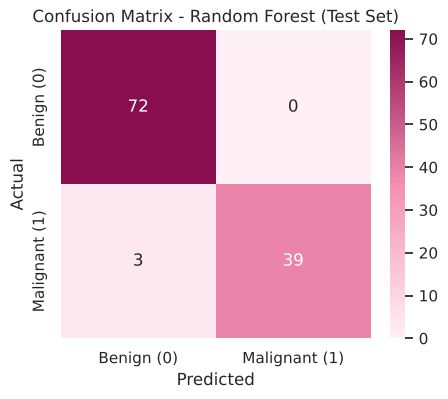
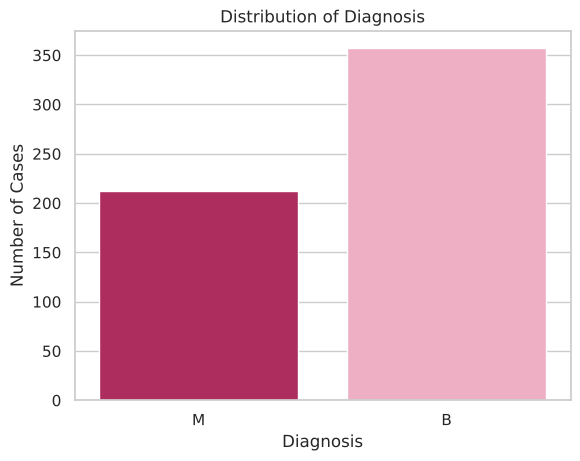
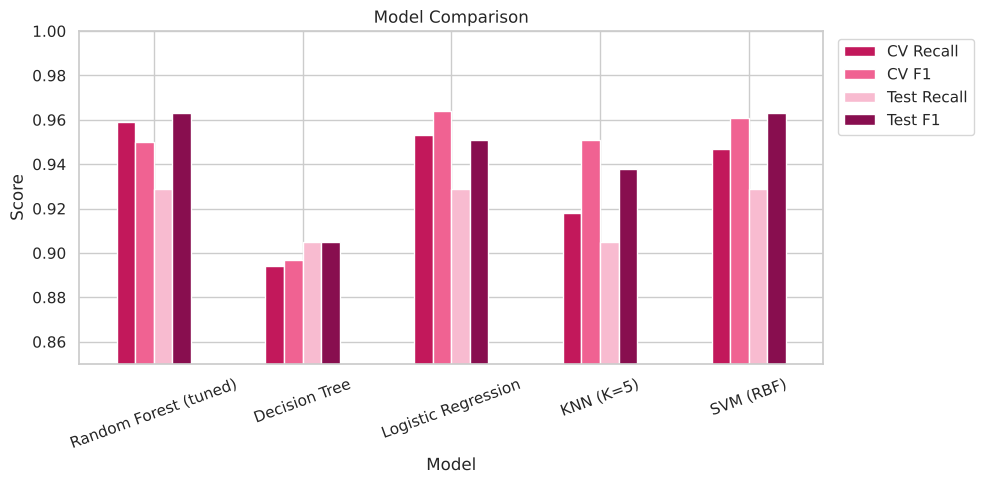
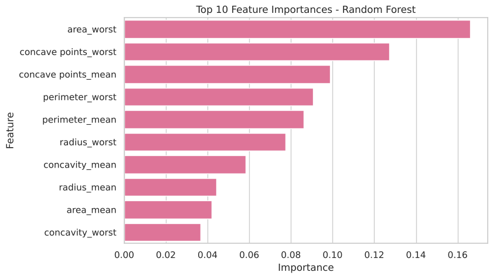

# Breast Cancer Classification Using Random Forest

A machine learning project that uses a **Random Forest Classifier** to predict whether a breast tumor is **benign** or **malignant** from measurements of cell nuclei.

This is a group mini project for *Classification Algorithms Exploration*. We explain how the algorithm works, explore the dataset, then train, tune and evaluate the model. We also compare it with four other classifiers.

## Team

- Lama Aldhalaan
- Ghadi Alshahrani
- Khalid Alotaibi
- Omar Mohammed

## Results at a Glance

Results of the final tuned model on **114 test patients** it never saw during training:

| Metric | Score |
|---|---|
| Accuracy | **97.4%** (111 of 114 correct) |
| Precision | **1.000** (no false alarms) |
| Recall | **0.929** (found 39 of 42 cancers) |
| F1 score | **0.963** |

<p align="center">
  
</p>

## Dataset

**[Breast Cancer Wisconsin (Diagnostic) Data Set](https://www.kaggle.com/datasets/uciml/breast-cancer-wisconsin-data)**, from Kaggle / UCI Machine Learning Repository.

- **569 patients** (tumor samples), **30 numeric features** and no missing values. The only gap is an empty `Unnamed: 32` column, which we drop.
- The features are computed from a digitized image of a fine needle aspirate (FNA) of a breast mass. They describe **10 properties of the cell nuclei**: radius, texture, perimeter, area, smoothness, compactness, concavity, concave points, symmetry and fractal dimension.
- Each property is given as a **mean**, a **standard error (se)** and a **worst** (largest) value.
- **Target:** `diagnosis`, where M = malignant and B = benign. The classes are 357 benign (63%) and 212 malignant (37%).

<p align="center">
  
</p>

## Project Structure

```
Breast_Cancer_Random_Forest/
├── Breast_Cancer_Random_Forest.ipynb   # Main notebook: all code, plots and explanations
├── data/
│   └── Breast_Cancer_Data.csv          # Dataset (569 rows × 33 columns)
├── images/                             # Charts used in this README
├── requirements.txt                    # Python packages needed
└── README.md
```

## Notebook Contents

1. **Introduction:** the problem and the prediction task.
2. **Algorithm Explanation:** what Random Forest is, how it works, when to use it, and its advantages and limitations.
3. **Exploratory Data Analysis (EDA):**
   - dataset structure and missing values
   - target distribution
   - histogram, box plot, bar plot, correlation heatmap and scatter plot
4. **Data Preprocessing:**
   - drop the empty and `id` columns
   - encode the target (M = 1, B = 0)
   - check duplicates and outliers
   - stratified 80/20 train/test split
   - test whether scaling is needed
5. **Model Training:** a baseline Random Forest evaluated with 5-fold stratified cross validation.
6. **Handling Class Imbalance:** `class_weight='balanced'`.
7. **Hyperparameter Tuning (Bonus):** `GridSearchCV` optimised for recall, plus a decision-threshold experiment.
8. **Model Evaluation:**
   - accuracy, precision, recall and F1
   - confusion matrix and classification report
   - baseline vs. tuned model
   - cross validation vs. test set
   - feature importance
9. **Model Comparison (Bonus):** against Decision Tree, Logistic Regression, KNN and SVM.
10. **Conclusion:** results, key insights, limitations and future work.

A clickable table of contents is at the end of the notebook.

## Approach

**Why recall?** In cancer diagnosis, missing a cancer (a false negative) is worse than a false alarm. So we focused on **recall** for the malignant class when choosing the model.

| Model (5-fold cross validation on the training set) | Recall | Missed cancers (of 170) |
|---|---|---|
| Baseline Random Forest | 0.941 | 10 |
| + `class_weight='balanced'` | 0.947 | 9 |
| **Tuned with grid search** | **0.959** | **7** |

Best parameters: `n_estimators=100`, `max_depth=None`, `min_samples_leaf=3`, `class_weight='balanced'`.

Feature scaling is **not** needed for Random Forest. We checked this: predictions were identical with and without `StandardScaler`, because trees split on thresholds and scaling doesn't change the order of the values.

## Model Comparison

All models use the same cross-validation folds and the same test set. Logistic Regression, KNN and SVM are scaled inside a pipeline.

| Model | CV Recall | Test Accuracy | Test Recall | Test F1 | Missed Cancers | False Alarms |
|---|---|---|---|---|---|---|
| **Random Forest (tuned)** | **0.959** | **97.4%** | 0.929 | **0.963** | 3 | 0 |
| SVM (RBF) | 0.947 | 97.4% | 0.929 | 0.963 | 3 | 0 |
| Logistic Regression | 0.953 | 96.5% | 0.929 | 0.951 | 3 | 1 |
| KNN (K=5) | 0.918 | 95.6% | 0.905 | 0.938 | 4 | 1 |
| Decision Tree | 0.894 | 93.0% | 0.905 | 0.905 | 4 | 4 |

<p align="center">
  
</p>

## Key Insights

- **Accurate and not overfitting:** test accuracy (97.4%) is close to cross-validation accuracy (96.3%).
- **Size and shape matter most:** the top features are `area_worst`, `concave points_worst` and `concave points_mean`. In other words, malignant nuclei are bigger and have more irregular, dented outlines.
- **All errors go in one direction:** 0 false alarms and 3 missed cancers. The baseline and the tuned model miss the same 3 borderline patients.
- **Many trees beat one:** Random Forest clearly outperforms a single Decision Tree and ties with SVM for the best test results.

<p align="center">
  
</p>

## Limitations

- The test set is small (114 patients, 42 malignant), so a single mistake changes recall by about 2.4%.
- The model still misses some cancers. It should **support** doctors, not replace them.

**Future work:**
- try a larger dataset
- try Gradient Boosting / XGBoost
- choose the decision threshold together with medical experts

## How to Run

1. Clone the repository:
   ```bash
   git clone https://github.com/Lam20010/Breast_Cancer_Random_Forest.git
   cd Breast_Cancer_Random_Forest
   ```
2. Install the requirements:
   ```bash
   pip install -r requirements.txt
   ```
3. Open the notebook and run all cells:
   ```bash
   jupyter notebook Breast_Cancer_Random_Forest.ipynb
   ```

The notebook reads the data from `data/Breast_Cancer_Data.csv`, so keep the folder structure as it is.

**On Google Colab:**
1. Upload the notebook.
2. Create a `data` folder in the Files panel.
3. Upload `Breast_Cancer_Data.csv` into the `data` folder.

The results were produced with Python 3, scikit-learn 1.7, pandas 2.3, matplotlib 3.11 and seaborn 0.13. A fixed `random_state=42` makes them reproducible.

## Acknowledgements

Dataset by W. H. Wolberg, W. N. Street and O. L. Mangasarian (University of Wisconsin), via the UCI Machine Learning Repository and Kaggle.
